# TP - Mise en place d'une architecture DMZ avec pfSense

## Informations Générales

Auteur : Hugo VOLANT
Formation : BTS SIO 2
Module : B2 SISR
Matériel : Proxmox VE, VM pfSense, conteneur LAMP, VM Debian

## Contextualisation

La société Vikor souhaite installer un serveur web dans son réseau. Ce serveur doit être accessible depuis le LAN de l'entreprise mais aussi depuis l'extérieur, c'est-à-dire Internet.

Pour sécuriser au maximum le réseau, le choix s'est porté sur pfSense.

Mission : installer pfSense avec 3 interfaces (WAN, LAN, DMZ), placer un serveur web LAMP dans la DMZ et le rendre accessible depuis le LAN et Internet.

💡 Ici, Internet correspond au réseau de la salle de TP (192.168.20.0/24).

## Schéma réseau et plan d'adressage


💡 Nous utilisons 3 bridges Proxmox. vmbr0 est celui qui existe déjà, il est relié à la carte physique donc à la salle. vmbr20 (LAN) et vmbr30 (DMZ) sont des bridges internes sans port physique, ce sont juste des switchs virtuels. Tout ce qui passe d'une zone à l'autre passe donc obligatoirement par pfSense.

| Zone | Bridge | Réseau          | IP pfSense            |
| ---- | ------ | --------------- | --------------------- |
| WAN  | vmbr0  | 192.168.20.0/24 | 192.168.20.101 (DHCP) |
| LAN  | vmbr20 | 192.168.10.0/24 | 192.168.10.1          |
| DMZ  | vmbr30 | 192.168.30.0/24 | 192.168.30.1          |

| Machine | Bridge | IP |
|---|---|---|
| Client Debian | vmbr20 | DHCP (192.168.10.100 à .199) |
| Serveur LAMP (conteneur) | vmbr30 | 192.168.30.10/24 |

| Interface | Adresse MAC | Carte Proxmox | Bridge | Rôle |
|---|---|---|---|---|
| vtnet0 | bc:24:11:ce:19:55 | net0 | vmbr0 | WAN |
| vtnet1 | bc:24:11:6d:bd:29 | net1 | vmbr20 | LAN |
| vtnet2 | bc:24:11:e0:2c:35 | net2 | vmbr30 | DMZ |

## Sommaire

- Partie 1 - Installation de pfSense
- Partie 2 - Serveur web dans la DMZ
- Partie 3 - NAT et règles de pare-feu
- Partie 4 - Tests
- Dépannage et sauvegarde
- Conclusion

## Partie 1 - Installation de pfSense

### Création des bridges

Dans Proxmox, nous allons dans Système puis Réseau puis Créer > Linux Bridge. Nous créons vmbr20 et vmbr30. Il faut laisser IPv4/CIDR, Gateway et Bridge ports vides, puis cliquer sur Apply Configuration.

💡 Nous ne touchons pas à vmbr0, c'est lui qui nous donne accès à la salle.

### Création de la VM

La VM pfSense a 2 cœurs, 2 Go de RAM et un disque de 16 Go. Elle possède 3 cartes réseau VirtIO :

- net0 sur vmbr0 (WAN)
- net1 sur vmbr20 (LAN)
- net2 sur vmbr30 (DMZ)

Nous décochons l'option Firewall de Proxmox sur les 3 cartes, c'est pfSense qui fait le filtrage.

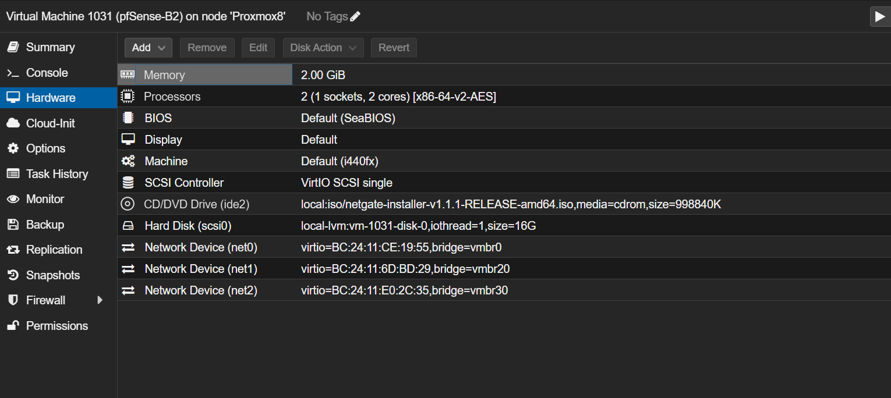

### Installation

Nous démarrons sur l'ISO Netgate Installer v1.1.1. Cet installeur télécharge pfSense depuis Internet, le WAN doit donc avoir un accès réseau pendant l'installation.

Dans l'installeur :

1. WAN sur vtnet0 en DHCP
2. LAN sur vtnet1 en statique, 192.168.10.1/24, avec un DHCP de 192.168.10.100 à 192.168.10.199
3. Choix de Install CE
4. Version 2.9.0
5. Système de fichiers ZFS

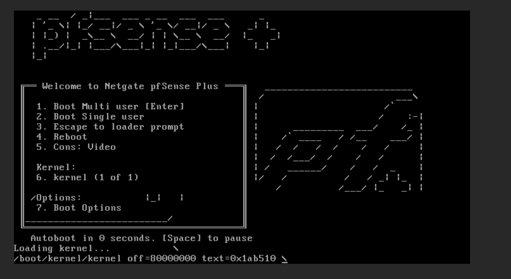

💡 L'installeur propose pfSense Plus (payant) ou CE (gratuit), nous prenons CE.

Une fois l'installation terminée, nous retirons l'ISO du lecteur (Hardware > CD/DVD Drive > Do not use any media) et nous redémarrons la VM.

Le menu console nous affiche le WAN en 192.168.20.101/24 (DHCP) et le LAN en 192.168.10.1/24.

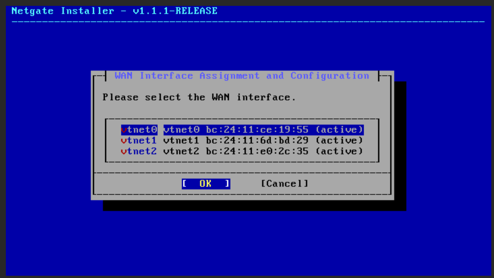
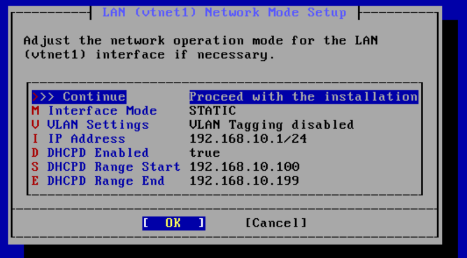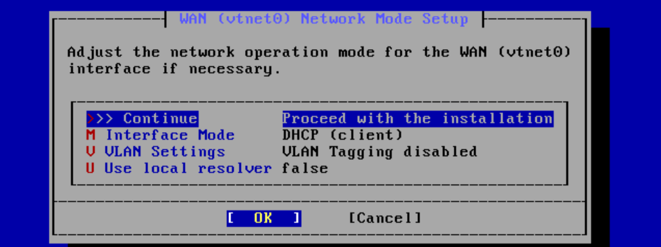
### Ajout de la DMZ

L'installeur ne propose que le WAN et le LAN, nous assignons donc vtnet2 depuis la console avec l'option 1 (Assign Interfaces). Nous mettons vtnet0 en WAN, vtnet1 en LAN et vtnet2 en OPT1.

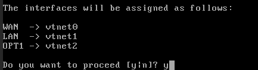

Puis avec l'option 2 (Set interface IP address), nous configurons OPT1 : pas de DHCP, adresse 192.168.30.1, masque 24, pas de passerelle et pas de serveur DHCP (le serveur web aura une IP fixe).

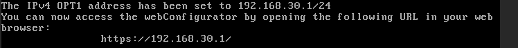

### Accès à l'interface web

Par défaut, l'interface web de pfSense n'est accessible que depuis le LAN. Nous mettons donc un client Debian sur vmbr20, il récupère une adresse dans le pool DHCP.

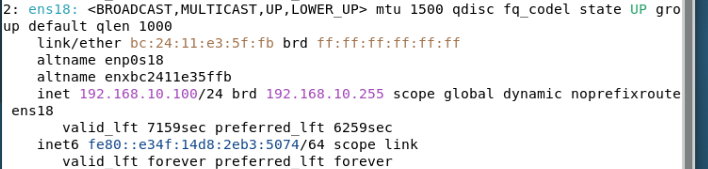

Nous tapons 192.168.10.1 dans le navigateur et nous arrivons sur la page de connexion de pfSense.

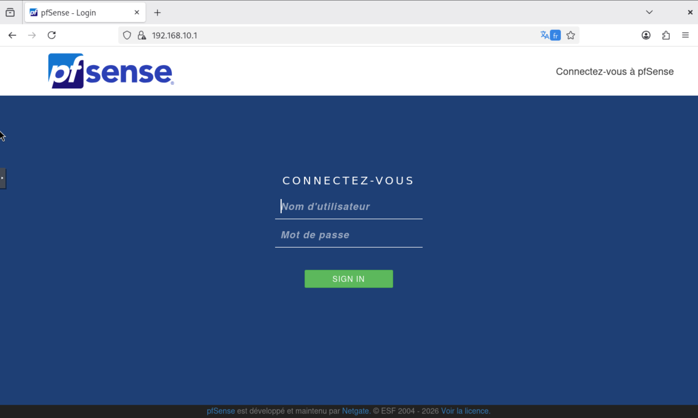

### Assistant de configuration

Après la connexion, nous arrivons sur le Setup Wizard. Nous réglons les infos générales : hostname pfSense, domaine home.arpa, DNS 1.1.1.1 et 8.8.8.8.

Sur l'écran du WAN, il faut absolument décocher Block RFC1918 Private Networks et Block bogon networks.

> 💡 Notre "Internet" est le réseau de la salle, qui est un réseau privé. Si ces options restent cochées, pfSense bloque tout ce qui arrive sur le WAN et le serveur web ne sera jamais joignable.

Pour le LAN, nous laissons l'adresse par défaut (192.168.10.1/24), sinon nous perdons l'accès à l'interface. Enfin nous mettons un mot de passe fort pour le compte admin.

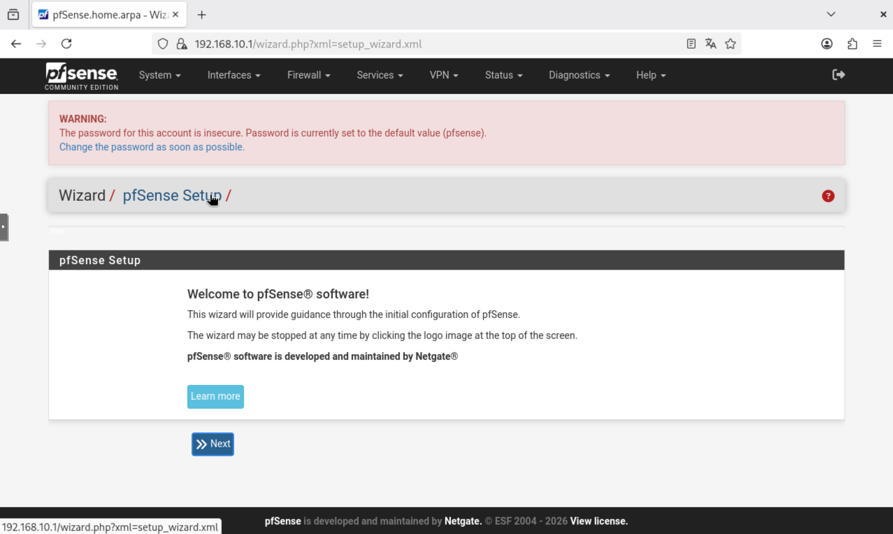
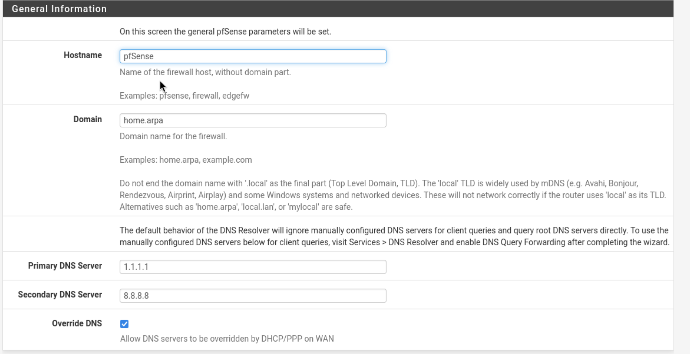
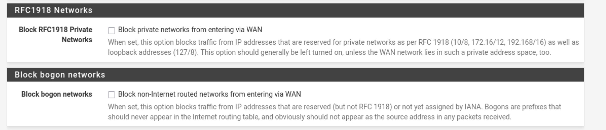

Nous arrivons ensuite sur le dashboard. Le widget Interfaces confirme nos 3 adresses :

| Interface  | Adresse        |
| ---------- | -------------- |
| WAN        | 192.168.20.101 |
| LAN        | 192.168.10.1   |
| OPT1 (DMZ) | 192.168.30.1   |

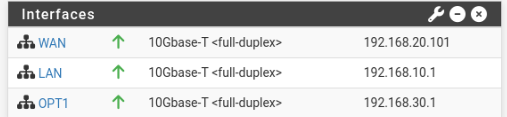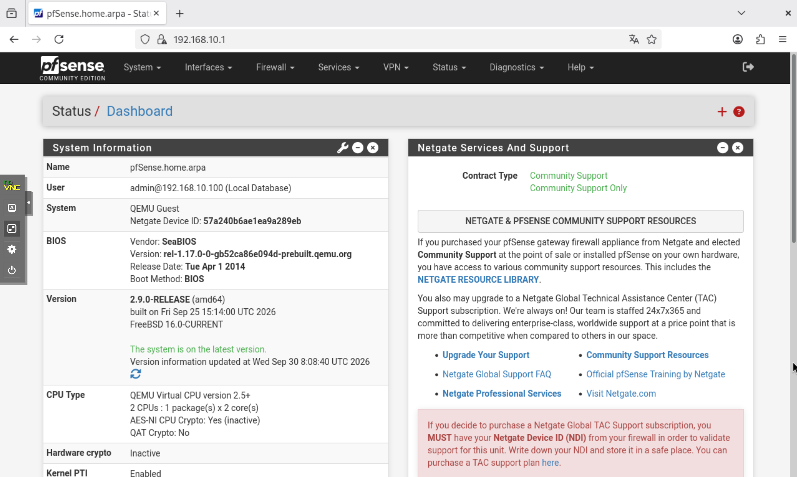

## Partie 2 - Serveur web dans la DMZ

Nous utilisons un conteneur qui possède déjà LAMP (Apache, MariaDB, PHP). Nous l'avons cloné puis reconfiguré pour la DMZ.

Configuration réseau du conteneur :

| Paramètre  | Valeur                   |
| ---------- | ------------------------ |
| Bridge     | vmbr30                   |
| IPv4       | Static, 192.168.30.10/24 |
| Passerelle | 192.168.30.1             |
| Firewall   | décoché                  |

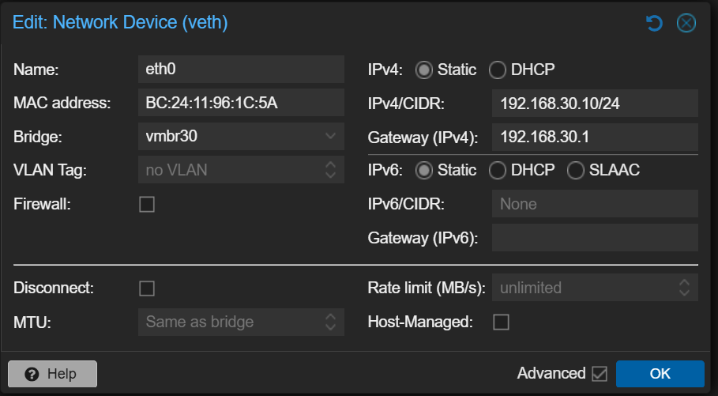

💡 Comme c'est un clone, nous vérifions que le conteneur d'origine n'utilise pas la même IP, nous changeons le hostname.

Nous testons ensuite depuis le conteneur :

```bash
ip a
ip route
systemctl status apache2
curl http://localhost
```

Le site répond en local. Par contre, le ping vers 192.168.30.1 ne passe pas. C'est normal, par défaut pfSense bloque tout sur une interface qui n'a aucune règle, c'est le cas de la DMZ.

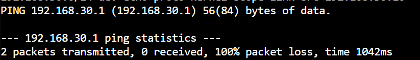

## Partie 3 - NAT et règles de pare-feu

Quelques points à retenir avant de configurer :

- Les règles s'appliquent sur l'interface d'où vient le trafic
- Elles sont lues de haut en bas, la première qui correspond est appliquée
- Sans règle, tout est bloqué (sauf sur le LAN où pfSense met une règle "allow any")
- pfSense est stateful, les réponses aux connexions autorisées passent toutes seules
- Le NAT change la destination du paquet, mais il faut aussi une règle qui l'autorise

### Accès depuis Internet

Le serveur web est en 192.168.30.10, une adresse privée que les postes de la salle ne connaissent pas. Nous allons donc utiliser l'adresse WAN de pfSense et rediriger le port 80 vers le serveur.

Dans Firewall > NAT > Port Forward, nous ajoutons une règle :

| Champ | Valeur |
|---|---|
| Interface | WAN |
| Protocol | TCP |
| Destination | WAN address |
| Destination port range | HTTP (80) |
| Redirect target IP | 192.168.30.10 |
| Redirect target port | HTTP (80) |
| Description | Web DMZ HTTP Lamp |
| Filter rule association | Add associated filter rule |

Nous sauvegardons puis nous cliquons sur Apply Changes.

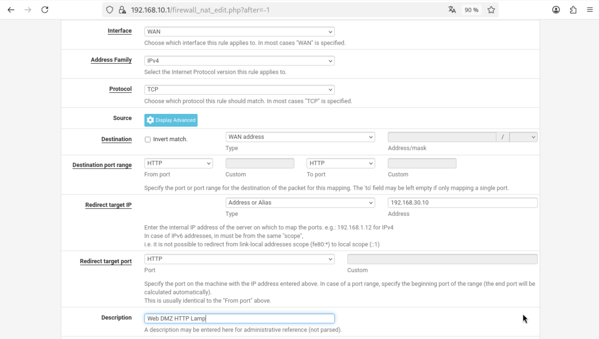

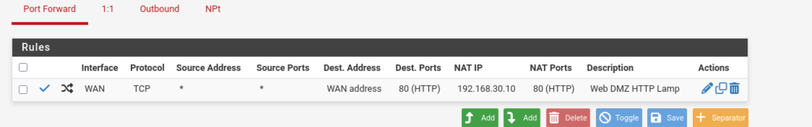

Concrètement, un poste de la salle tape http://192.168.20.101, pfSense redirige vers 192.168.30.10:80, et la réponse repasse par pfSense.

### Accès depuis le LAN

Le LAN a déjà la règle "Default allow LAN to any". Les clients accèdent donc directement à 192.168.30.10, pfSense fait juste du routage entre le LAN et la DMZ.

### Durcissement des règles

L'intérêt d'une DMZ c'est l'isolation. Si le serveur web est compromis, il ne doit pas pouvoir atteindre le LAN. Nous ajoutons donc une règle dans Firewall > Rules > DMZ :

| Champ | Valeur |
|---|---|
| Action | Block |
| Interface | DMZ |
| Protocol | Any |
| Source | DMZ subnets |
| Destination | LAN subnets |
| Description | DMZ vers LAN bloqué |

⚠️ Il faut bien choisir DMZ subnets en source et pas DMZ address. DMZ address correspond seulement à l'IP de pfSense sur la DMZ (192.168.30.1), pas au serveur et donc la règle ne bloquerait rien.

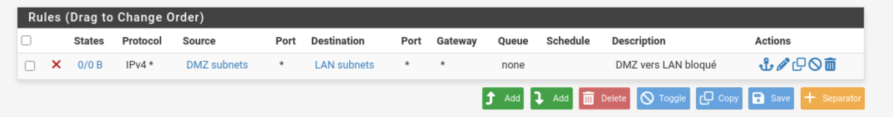

💡 La DMZ n'a aucune règle Pass, donc tout est déjà bloqué par défaut. 
## Partie 4 - Tests

Depuis un poste de la salle, nous tapons http://192.168.20.101 et la page du LAMP s'affiche. La redirection de port fonctionne.

| Test                  | Depuis            | Attendu      | Résultat |
| --------------------- | ----------------- | ------------ | -------- |
| http://192.168.20.101 | Poste de la salle | Page du LAMP | OK       |
| http://192.168.30.10  | Client LAN        | Page du LAMP | OK       |
| https://192.168.30.1  | Client LAN        | Bloqué       | OK       |
| ping 192.168.10.100   | Conteneur LAMP    | Bloqué       | OK       |

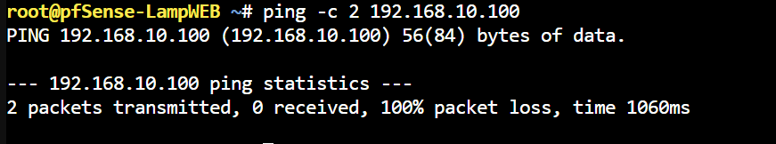
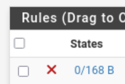

## Conclusion

Ce TP nous a permis de mettre en place une architecture DMZ avec pfSense sur Proxmox. Les trois zones (WAN, LAN, DMZ) sont isolées et ne communiquent que par pfSense, grâce à des bridges.


