# Partie 2 - Mise en place d'un package sous pfSense

## Contextualisation

Nous venons d'installer pfSense pour la société LSL, avec un accès au serveur web situé dans la DMZ. Le DSI souhaite maintenant pouvoir **monitorer**, via un navigateur, le maximum d'informations concernant le réseau LAN.

Notre architecture reste la même que dans le TP précédent.

| Zone | Réseau          | IP pfSense            |
| ---- | --------------- | --------------------- |
| WAN  | 192.168.20.0/24 | 192.168.20.101 (DHCP) |
| LAN  | 192.168.10.0/24 | 192.168.10.1          |
| DMZ  | 192.168.30.0/24 | 192.168.30.1          |

## Étape 1 : choix de la solution de monitoring

### Ce que demande le DSI

Avant de choisir, nous listons les besoins :

- Consulter les informations depuis un navigateur
- Voir ce qui se passe sur le LAN (quelles machines, quels protocoles, quel volume)
- Une solution adaptée à pfSense, donc facile à installer dessus
- Une installation légère, notre VM n'a que 4 Go de RAM

### Les solutions étudiées

**Le monitoring natif de pfSense**
pfSense propose déjà des graphiques dans Status > Monitoring (débit, charge CPU, états de connexion). C'est intégré et ça ne coûte rien. Par contre, on ne sait pas quelle machine du LAN consomme ou ce qu'elle fait, on a seulement une vue globale de l'interface.

**Zabbix ou Nagios**
Ce sont des outils de supervision complets, avec des alertes et un historique. Ils fonctionnent en général avec un serveur dédié et des agents sur chaque machine. C'est bien plus long à mettre en place et trop lourd pour notre besoin, qui concerne surtout l'analyse du trafic du LAN.

**Snort ou Suricata**
Ce sont des systèmes de détection d'intrusion. Ils servent à repérer des attaques, pas à observer l'activité du réseau. Ils répondent donc à un autre besoin que celui du DSI.

**ntopng**
ntopng est un outil d'analyse du trafic réseau en temps réel, disponible comme package pfSense. Il s'installe depuis le Package Manager et il est consultable depuis un navigateur. Il permet de voir :

- la liste des machines du LAN qui communiquent
- les protocoles et applications utilisés
- le volume de données échangé par machine
- les connexions actives
- un historique du trafic

Ses limites : il consomme de la RAM et certaines fonctions avancées sont réservées aux versions payantes.

### Tableau comparatif

| Critère                     | Monitoring natif | Zabbix / Nagios          | Snort / Suricata                 | **ntopng**  |
| --------------------------- | ---------------- | ------------------------ | -------------------------------- | ----------- |
| Accès via navigateur        | Oui              | Oui                      | Oui                              | **Oui**     |
| Détail par machine du LAN   | Non              | Partiel (avec agents)    | Non                              | **Oui**     |
| Analyse des protocoles      | Non              | Non                      | Oui (pour détecter des attaques) | **Oui**     |
| Installation sur pfSense    | Déjà intégré     | Serveur dédié nécessaire | Package                          | **Package** |
| Difficulté de mise en place | Aucune           | Élevée                   | Moyenne                          | **Faible**  |
| Poids sur la VM             | Faible           | Élevé                    | Élevé                            | **Moyen**   |
| Adapté au besoin du DSI     | Insuffisant      | Trop lourd               | Autre usage                      | **Oui**     |

### Notre choix

Nous choisissons **ntopng**.

Le DSI veut le maximum d'informations sur le LAN, accessibles depuis un navigateur. ntopng est le seul de ces outils qui donne le détail machine par machine et protocole par protocole, sans serveur supplémentaire. Il s'installe en quelques clics depuis le Package Manager de pfSense, ce qui est adapté à la durée du TP.

Pour la configuration, nous le ferons écouter sur l'interface **LAN**, puisque c'est le réseau que le DSI veut surveiller.

💡 Le monitoring natif de pfSense reste utile en complément, par exemple pour voir la charge CPU et la RAM de la VM une fois ntopng lancé.

### Points de vigilance

- **Accès Internet de pfSense** : le package est téléchargé depuis les dépôts de pfSense, le WAN doit donc avoir un accès Internet et un DNS qui fonctionne.
- **Mémoire** : notre VM a 2 Go de RAM. Nous surveillerons le dashboard après l'installation, et nous augmenterons la mémoire si la VM ralentit.
- **Compatibilité** : nous utilisons pfSense CE 2.9.0, une version très récente. Nous vérifierons que le package ntopng apparaît bien dans la liste des packages disponibles avant de continuer.
- **Sauvegarde** : avant l'installation, nous faisons un snapshot de la VM dans Proxmox et nous exportons la configuration (Diagnostics > Backup & Restore), pour pouvoir revenir en arrière en cas de problème.

ntopng :
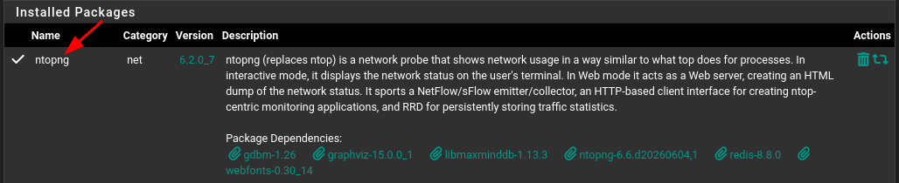

## Étape 2 : Mise en place de ntopng

### Préparation

Avant d'installer le package, nous faisons deux sauvegardes pour pouvoir revenir en arrière.

Nous commençons par un snapshot de la VM pfSense dans Proxmox, que nous appelons avant-addon.

Puis nous exportons la configuration de pfSense dans Diagnostics > Backup & Restore, avec le bouton Download configuration as XML.

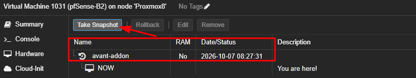
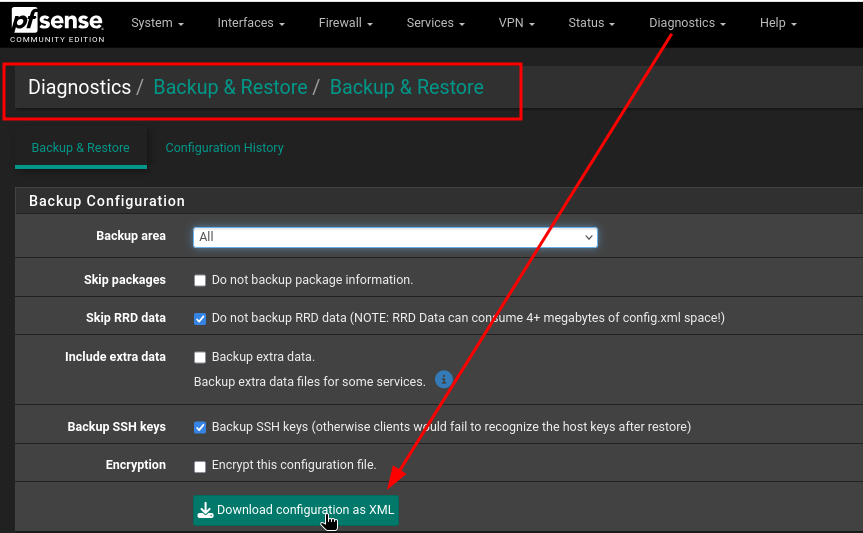
💡 Le snapshot est pris sans la RAM, ce qui suffit pour revenir à l'état de la VM avant l'installation.
### Installation du package

Nous allons dans **System > Package Manager > Available Packages** et nous cherchons **ntopng**.

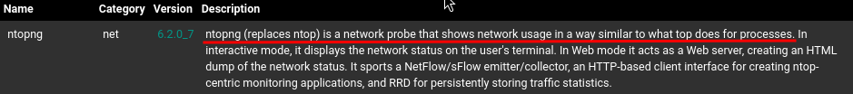

Il suffit de cliquer sur Install puis Confirm.

Le message pfSense-pkg-ntopng installation successfully completed s'affiche à la fin, le package est donc bien installé.

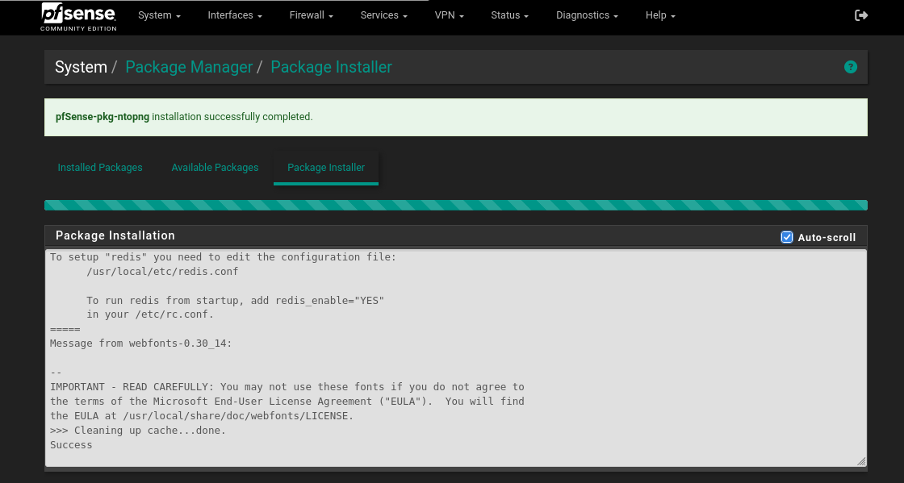
### Configuration

Un nouveau menu apparaît : Diagnostics > ntopng Settings.

Nous réglons les paramètres suivants :

|Paramètre|Valeur|
|---|---|
|Enable ntopng|Coché|
|Admin password|Mot de passe fort|
|Interface|LAN|
|Autres options|Valeurs par défaut|

Nous choisissons l'interface LAN car c'est le réseau que le DSI veut surveiller.

Nous cliquons sur Save, le service démarre à l'enregistrement.
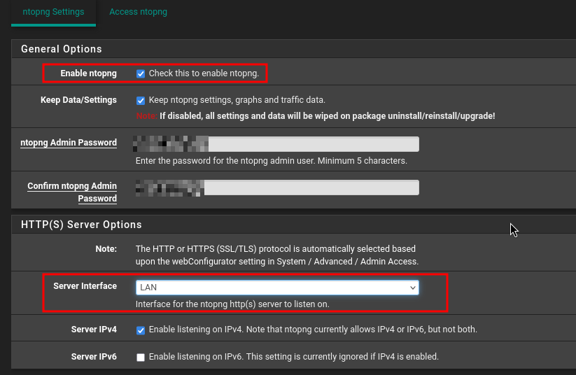

💡 Nous pouvons vérifier que le service tourne dans Status > Services, ntopng doit être en vert (démarré).

### Accès à l'interface

Nous nous connectons depuis le client Debian du LAN. Sur la page **ntopng** **Settings**, le lien Access ntopng ouvre l'interface. Sinon, il suffit de taper l'adresse de pfSense avec le port de ntopng (3000 par défaut) dans le navigateur.

https://192.168.10.1:3000

Nous nous identifions avec l'utilisateur admin et le mot de passe défini juste avant.

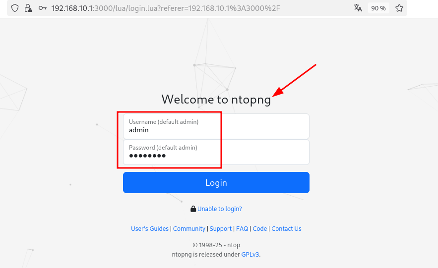

💡 Aucune règle de pare-feu n'est à ajouter. Le trafic part du LAN vers l'adresse LAN de pfSense, et la règle par défaut "allow LAN to any" l'autorise déjà.

Nous arrivons sur le tableau de bord de ntopng.

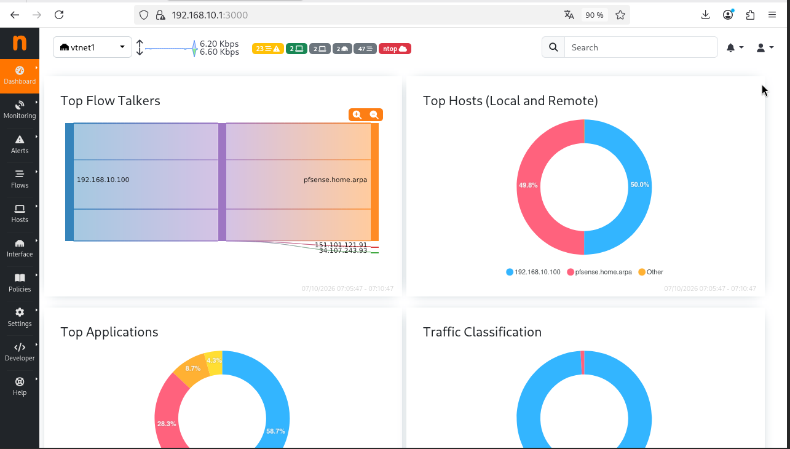

### Surveillance des ressources

Comme notre VM ne dispose que de 4 Go de RAM, nous regardons l'utilisation de la mémoire sur le dashboard de pfSense une fois ntopng lancé.

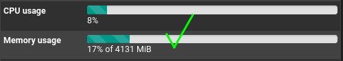

Tout est bon, les usages sont loin de la capacité maximale de notre pfSense.

### Validation

Pour valider, nous générons du trafic depuis le client Debian du LAN :

- navigation sur quelques sites web
- ping vers 8.8.8.8
- accès au serveur web de la DMZ (http://192.168.30.10)

Nous retournons ensuite sur ntopng et nous vérifions que ce trafic apparaît.

Les informations que nous retrouvons :

| Information                         | Où la voir dans ntopng          | Constat                                                                           |
| ----------------------------------- | ------------------------------- | --------------------------------------------------------------------------------- |
| Machines du LAN                     | Hosts                           | Nous voyons les deux machines du LAN (.10 et .100)                                |
| Protocoles et applications utilisés | Hôte > Applications / Protocols | Vision des applications utilisées et des sites visitées (voir capture ci-dessous) |
| Volume de trafic par machine        | Hosts (colonne trafic)          | Vision du volume entre réception et envoi par machine                             |
| Connexions actives                  | Flows                           | Vision sur les connexions en cours, avec ports utilisés et info complémentaires   |

**Machines du LAN** :
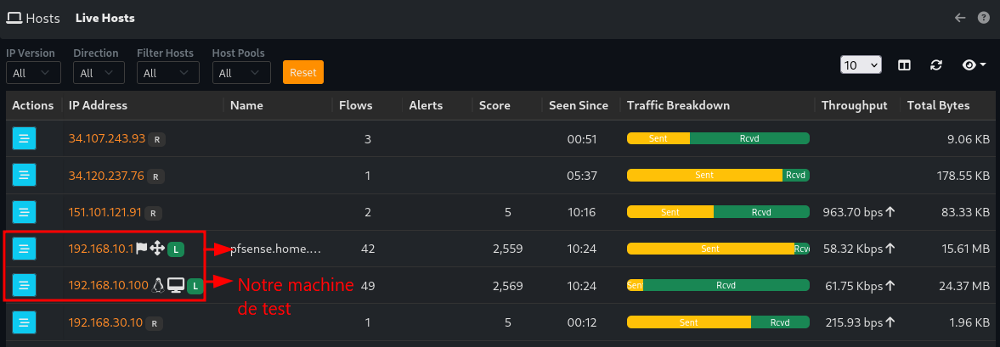

**Protocoles et applications utilisés** :
Dans le détail de notre client (192.168.10.100), l'onglet Apps nous montre les applications utilisées. Nous retrouvons les sites que nous avons visités, comme Amazon et Wikipedia, ainsi que le DNS. La majorité du trafic est en TLS, c'est-à-dire du HTTPS chiffré.
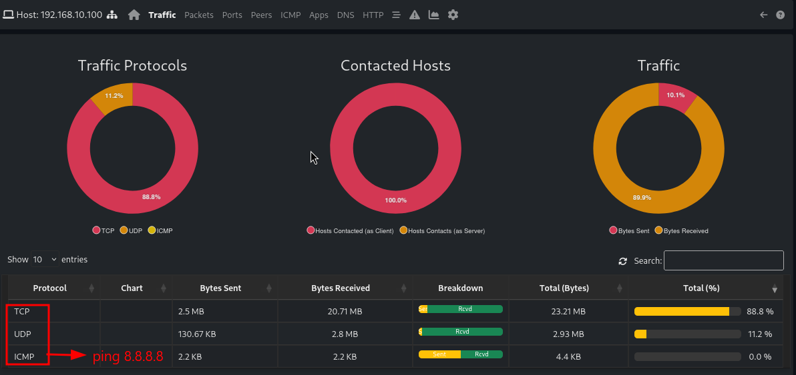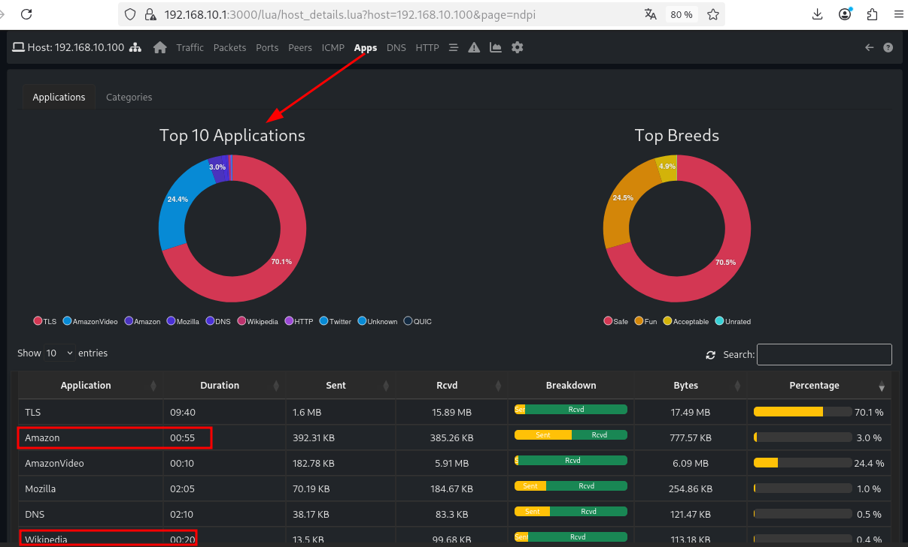

Liste des flux avec la connexion vers **192.168.30.10** :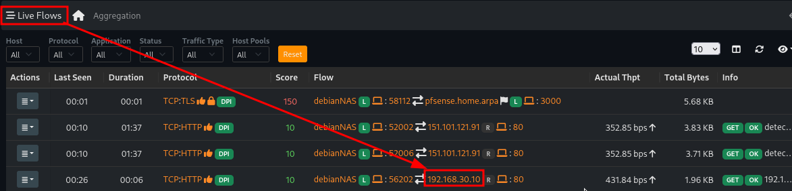

**Graphique de trafic en temps réel :**
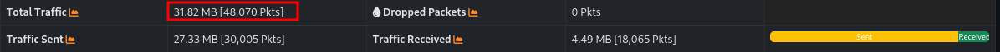

Nous voyons ici que le trafic est très bas car nous avons qu'un seul utilisateur test et aucune requête de téléchargement, de streaming, etc...
## Conclusion de la situation 1

Nous avons choisi ntopng pour répondre au besoin du DSI : monitorer, depuis un navigateur, le maximum d'informations sur le réseau LAN. Le package s'est installé depuis le Package Manager de pfSense, et nous l'avons configuré sur l'interface LAN.

Le trafic généré depuis le client est bien visible dans ntopng, machine par machine, avec les protocoles utilisés et les connexions actives. Cela répond au cahier des charges.

Limites : ntopng consomme de la mémoire sur notre petite VM, et certaines fonctions avancées de la version gratuite sont limitées. Pour aller plus loin, nous pourrions ajouter des alertes, ou compléter avec un outil de supervision comme Zabbix pour surveiller l'état des machines.

## Mise en situation 2 : bureau à distance sous pfSense

### Contextualisation

Le DSI souhaite maintenant installer un serveur Windows dans la DMZ, accessible en bureau à distance via le protocole RDP, et ce depuis Internet.

Par mesure de sécurité, nous n'utilisons pas le port par défaut (3389) côté WAN. Nous choisissons un autre port, associé à l'adresse WAN de pfSense, avec une redirection du flux vers l'adresse du serveur Windows sur le port par défaut.

Le sujet nous demande ce schéma :

@WAN pfSense : port de notre choix **vers** @serveur Windows : port par défaut (3389)

### Plan d'adressage

|Élément|Valeur|
|---|---|
|Serveur Windows Server 2016|VM sur vmbr30 (DMZ), 192.168.30.20/24, passerelle 192.168.30.1|
|Client Windows 11 (simule Internet)|VM sur vmbr0 (réseau de la salle), IP en 192.168.20.x (DHCP)|
|Adresse WAN de pfSense|192.168.20.101|
|Port choisi côté WAN|54590|
|Port du serveur|3389 (RDP par défaut)|

Redirection mise en place :

**192.168.20.101 : 54590 vers 192.168.30.20 : 3389**

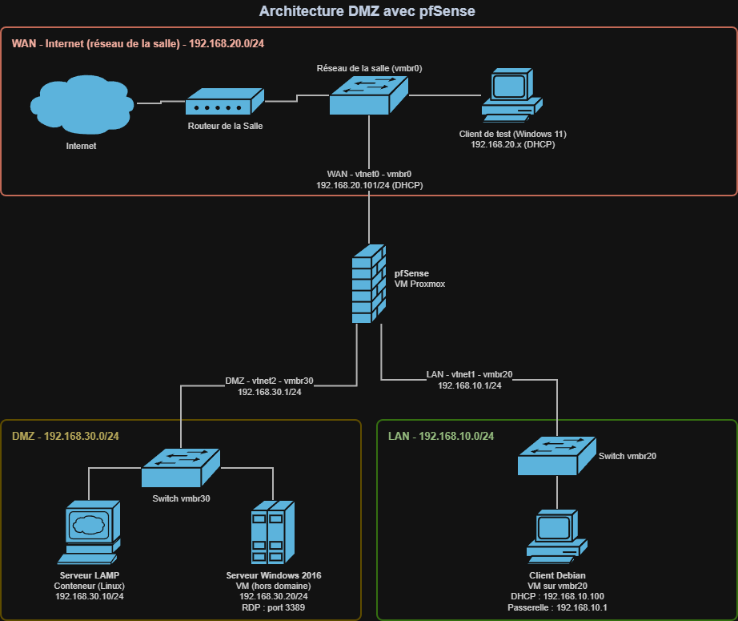

### Choix du port

Nous ne gardons pas le port 3389, c'est le premier port testé par les scans automatiques sur Internet. Nous choisissons le port **54590**.

Ce port est dans la plage 49152 à 65535, réservée aux ports dynamiques. Aucun service courant ne l'utilise, il n'y a donc pas de conflit avec pfSense. Nous évitons aussi un port trop proche de 3389 (comme 33890), qui serait facile à deviner.

💡 Changer le port ne protège pas vraiment le service. Un scan complet de tous les ports le retrouve. C'est une mesure de discrétion qui évite les attaques automatiques sur le port par défaut, pas une vraie sécurité.

### Étape 1 : préparation du serveur Windows en DMZ

#### Choix : serveur hors domaine

Nous utilisons notre VM Windows Server 2016 et nous la plaçons **hors du domaine**.

Une DMZ est une zone exposée. Si le serveur est compromis, l'attaquant ne doit pas avoir de lien avec l'Active Directory de l'entreprise. De plus, notre règle de pare-feu bloque tout ce qui part de la DMZ vers le LAN, le serveur ne pourrait donc pas joindre le contrôleur de domaine de toute façon.

Nous utilisons donc un compte local avec un mot de passe fort.

#### Configuration réseau

Dans Proxmox, nous branchons la carte de la VM sur **vmbr30** et nous décochons l'option Firewall.

Dans Windows, nous configurons l'adresse en statique :

|Paramètre|Valeur|
|---|---|
|Adresse IP|192.168.30.20|
|Masque|255.255.255.0|
|Passerelle|192.168.30.1|
|DNS|1.1.1.1 (ou 192.168.30.1)|

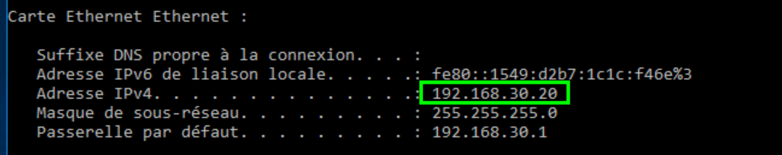

Un ping vers la passerelle 192.168.30.1 ne fonctionne pas pour l'instant. C'est normal, la DMZ n'a aucune règle Pass dans pfSense, tout y est bloqué par défaut.

### Étape 2 : activation du bureau à distance

Sur le serveur, dans le Gestionnaire de serveur > Serveur local, nous cliquons sur Bureau à distance (affiché "Désactivé") et nous autorisons les connexions à distance à cet ordinateur.

Nous laissons cochée l'option d'authentification au niveau du réseau (NLA), qui oblige l'utilisateur à s'authentifier avant l'ouverture de la session.

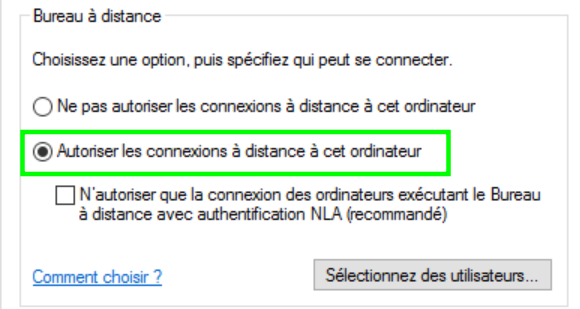

Nous vérifions ensuite le pare-feu Windows. La règle "Bureau à distance" doit être activée, y compris pour le profil Public, car Windows peut classer le réseau de la DMZ comme public.

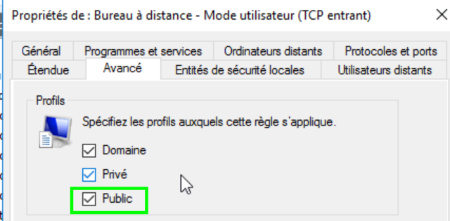

### Étape 3 : configuration de pfSense

#### Redirection de port (NAT)

Dans Firewall > NAT > Port Forward, nous ajoutons une règle :

|Champ|Valeur|
|---|---|
|Interface|WAN|
|Protocol|TCP|
|Destination|WAN address|
|Destination port range|Custom : 54590 à 54590|
|Redirect target IP|192.168.30.20|
|Redirect target port|MS RDP (3389)|
|Description|RDP Windows DMZ|
|Filter rule association|Add associated filter rule|

Nous cliquons sur Save puis sur Apply Changes.

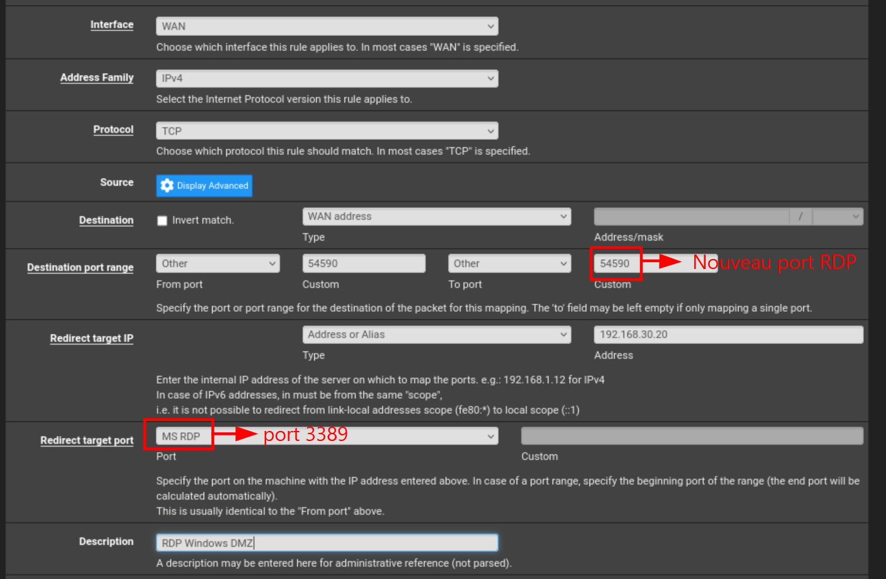

💡 La différence avec notre redirection HTTP du TP précédent, c'est que le port d'entrée (54590) n'est pas le même que le port de sortie (3389). pfSense reçoit la connexion sur le 54590 et la transmet au serveur sur son port RDP par défaut.

#### Vérification de la règle WAN

Dans Firewall > Rules > WAN, nous vérifions la règle créée automatiquement.

|Colonne|Valeur attendue|
|---|---|
|Protocole|IPv4 TCP|
|Destination|192.168.30.20|
|Port|3389 (MS RDP)|

💡 La règle WAN affiche le port 3389 et non 54590. pfSense applique le NAT avant le filtrage, la règle porte donc sur le port final du serveur. C'est une erreur fréquente quand on crée la règle à la main.

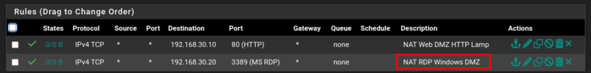

### Étape 4 : validation

#### Poste de test

Pour simuler Internet, nous utilisons notre VM Windows 11, branchée sur **vmbr0**. Elle récupère une adresse en 192.168.20.x par DHCP, comme les postes de la salle. Elle n'est pas dans le domaine.

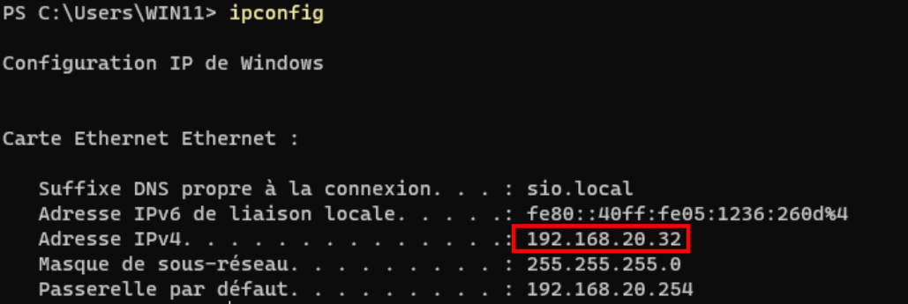

#### Test de connexion

Depuis le client Windows 11, nous lançons le Bureau à distance (mstsc) avec l'adresse de pfSense suivie du port :

**192.168.20.101:54590**

Nous entrons les identifiants du compte local du serveur. La session s'ouvre sur le serveur Windows de la DMZ.

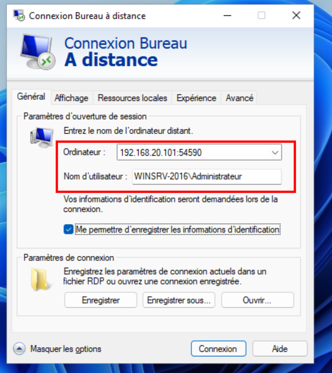

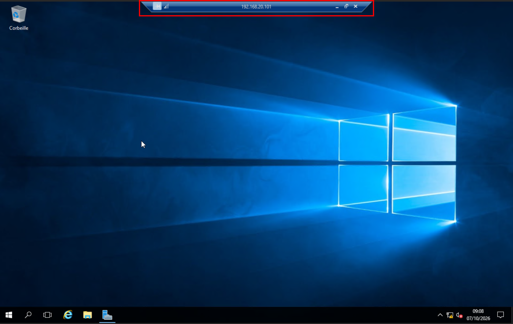

#### Tests complémentaires

| Test                             | Commande / action                   | Attendu                   | Résultat |
| -------------------------------- | ----------------------------------- | ------------------------- | -------- |
| Connexion sur le port choisi     | mstsc vers 192.168.20.101**:54590** | Session ouverte           | Valide   |
| Connexion sur le port par défaut | mstsc vers 192.168.20.101           | Échec rien n'est redirigé | Erreur   |

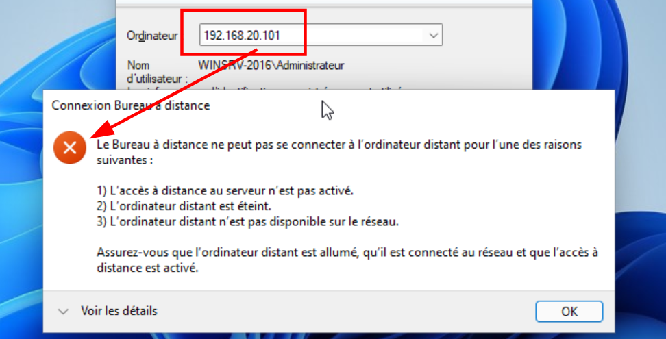

Nous vérifions aussi dans pfSense que le trafic passe bien par la règle : dans **Firewall > Rules > WAN**, le compteur d'états de la règle RDP augmente après notre connexion.

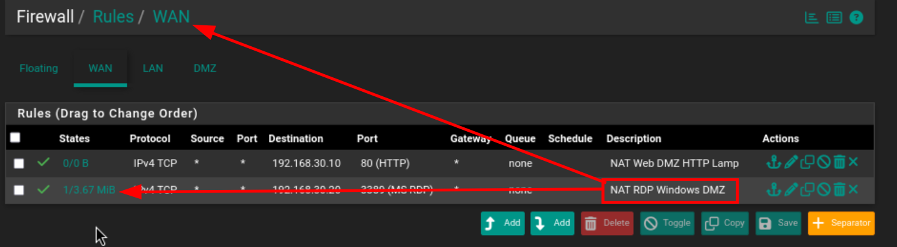
### Conclusion de la situation 2

Nous avons mis en place un serveur Windows dans la DMZ, accessible en bureau à distance depuis l'extérieur. Le flux arrive sur l'adresse WAN de pfSense sur le port 54590, puis il est redirigé vers le serveur sur le port RDP par défaut 3389.

Le serveur est hors domaine pour isoler la DMZ du réseau interne, et seule la redirection nécessaire est ouverte sur le WAN. Les tests depuis notre client Windows 11 valident le cahier des charges : la connexion fonctionne sur le port choisi et échoue sur le port par défaut.

